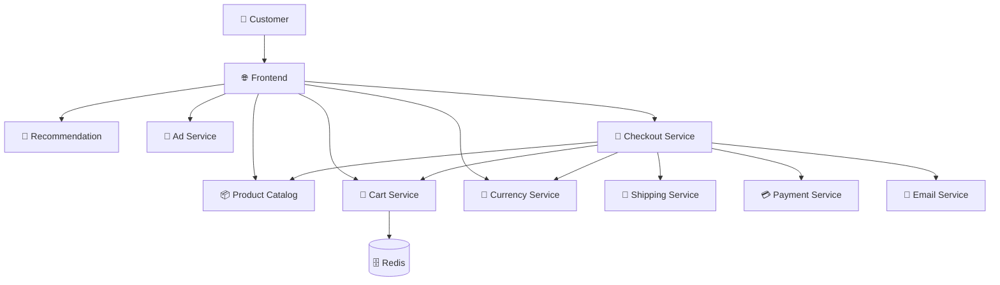
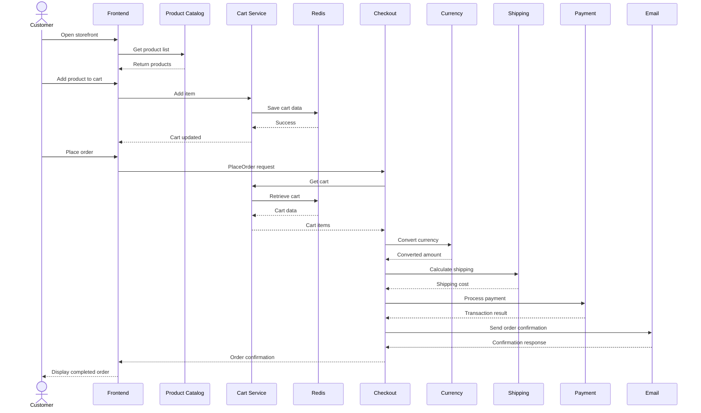
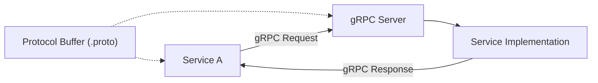
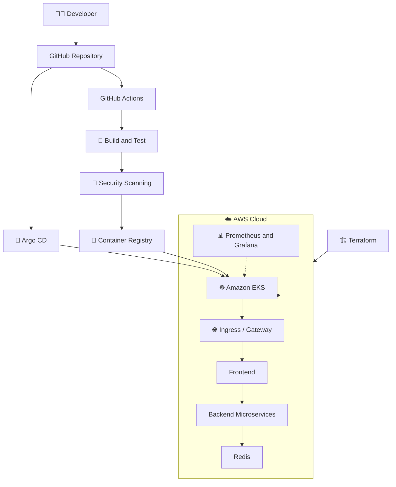
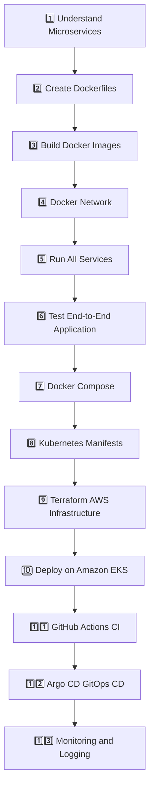

# 🛒 Microservices E-Commerce Application

A containerized, cloud-native **Microservices E-Commerce Application** built to understand and implement real-world microservices architecture, inter-service communication, containerization, and DevOps deployment practices.

The application simulates an online shopping platform where users can browse products, view recommendations, add products to their cart, and complete the checkout process.

The project is currently running locally using Docker containers connected through a custom Docker bridge network. The next phase is to automate the deployment using **GitHub Actions, Kubernetes, Argo CD, and Amazon EKS**.

---

## 📌 Table of Contents

- [🎯 Project Overview](#-project-overview)
- [🏗️ Architecture](#️-architecture)
- [🔄 Application Workflow](#-application-workflow)
- [🧩 Microservices](#-microservices)
- [🛠️ Technology Stack](#️-technology-stack)
- [📡 Service Communication](#-service-communication)
- [🐳 Local Docker Deployment](#-local-docker-deployment)
- [🧪 Application Testing](#-application-testing)
- [📊 Current Implementation Status](#-current-implementation-status)
- [☁️ Planned AWS EKS Architecture](#️-planned-aws-eks-architecture)
- [🗺️ Project Roadmap](#️-project-roadmap)
- [📚 Key Learnings](#-key-learnings)

---

## 🎯 Project Overview

This project demonstrates how a traditional e-commerce application can be designed using independently deployable microservices.

Instead of building one large monolithic application, the system is divided into smaller services. Each service is responsible for a specific business capability.

### ✨ Key Features

- 🛍️ Browse and explore products.
- 🔍 View individual product details.
- 🛒 Add products to the shopping cart.
- 📦 Manage cart items using Redis.
- 💱 Convert prices into different currencies.
- 🎯 Display product recommendations.
- 📢 Display contextual advertisements.
- 🚚 Calculate shipping costs.
- 💳 Simulate payment processing.
- 📧 Generate order confirmation email requests.
- ✅ Complete the checkout workflow.

---

## 🏗️ Architecture

The application follows a microservices architecture in which independent services communicate with each other to complete business operations.

### High-Level Architecture Diagram



### Architecture Explanation

| Component | Responsibility |
|---|---|
| Frontend | User interface and customer requests |
| Product Catalog | Product information and product listing |
| Cart | Shopping cart operations |
| Redis | Stores shopping cart data |
| Checkout | Coordinates the order placement workflow |
| Payment | Simulates payment processing |
| Shipping | Shipping cost calculation and order shipping |
| Currency | Currency conversion |
| Recommendation | Product recommendations |
| Email | Order confirmation email requests |
| Ad | Contextual advertisements |

---

## 🔄 Application Workflow

The following diagram represents the main shopping and checkout process.



---

## 🧩 Microservices

The application contains the following services:

| Service | Port | Responsibility |
|---|---:|---|
| Frontend | 8080 | Customer-facing web application |
| Product Catalog | 3550 | Product information |
| Cart Service | 7070 | Shopping cart management |
| Checkout Service | 5050 | Order orchestration |
| Recommendation | 8080 | Product recommendations |
| Currency | 7000 | Currency conversion |
| Payment | 50051 | Simulated payment processing |
| Shipping | 50051 | Shipping operations |
| Email | 8080 | Email notification requests |
| Ad Service | 9555 | Advertisement delivery |
| Redis | 6379 | Cart data storage |

**Note:** These are internal container ports. The frontend is published on host port `8081` in the current local Docker setup.

### 1. 🌐 Frontend Service

- Provides the customer-facing e-commerce interface.
- Displays products and product details.
- Allows customers to add items to their cart.
- Initiates checkout requests.
- Communicates with backend microservices.

### 2. 📦 Product Catalog Service

- Maintains product information.
- Provides product listings.
- Returns product details.
- Communicates with other services through gRPC.

### 3. 🛒 Cart Service

- Manages shopping cart operations.
- Adds and retrieves cart items.
- Uses Redis as its storage backend.
- Exposes gRPC endpoints.

### 4. 🧾 Checkout Service

- Coordinates the order placement process.
- Retrieves cart information.
- Requests currency conversion.
- Calculates shipping costs.
- Invokes payment processing.
- Requests order confirmation emails.

### 5. 🎯 Recommendation Service

- Provides product recommendations.
- Receives product IDs.
- Communicates with Product Catalog.
- Exposes a gRPC service.

### 6. 💱 Currency Service

- Converts product prices between currencies.
- Provides currency conversion functionality.
- Communicates through gRPC.

### 7. 💳 Payment Service

- Simulates payment processing.
- Receives payment requests from Checkout.
- Returns transaction results.
- Does not process real financial transactions.

### 8. 🚚 Shipping Service

- Calculates shipping costs.
- Handles shipping-related requests.
- Communicates with Checkout Service.

### 9. 📧 Email Service

- Receives order confirmation requests.
- Handles email notification functionality.

### 10. 📢 Ad Service

- Provides contextual advertisements.
- Returns advertisements based on the application request.

### 11. 🗄️ Redis

- Stores shopping cart data.
- Allows Cart Service to retrieve and update cart information.

---

## 🛠️ Technology Stack

| Category | Technologies |
|---|---|
| Architecture | Microservices |
| Frontend | Web-based storefront |
| Backend | Go, Python, Node.js, Java, .NET |
| Communication | gRPC |
| Protocol Definition | Protocol Buffers |
| Database / Cache | Redis |
| Containerization | Docker |
| Container Networking | Docker Bridge Network |
| Orchestration — Planned | Kubernetes |
| Cloud — Planned | AWS |
| Container Platform — Planned | Amazon EKS |
| CI/CD — Planned | GitHub Actions |
| GitOps — Planned | Argo CD |
| Infrastructure as Code — Planned | Terraform |

---

## 📡 Service Communication

The microservices communicate primarily through **gRPC**, using Protocol Buffers to define service contracts and request/response messages.

### How gRPC Communication Works



### Important Concepts

- **gRPC:** Enables communication between backend microservices.
- **Protocol Buffers:** Define service methods and message structures.
- **Docker DNS:** Allows containers on the same user-defined bridge network to communicate using container names.
- **Internal Ports:** Services communicate using their container ports rather than host-published ports.

Example:

```text
Frontend
   |
   | gRPC
   v
cartservice:7070
   |
   v
redis-cart:6379
```

The `cartservice` container can access Redis using the hostname `redis-cart` because both containers are connected to the same Docker network.

---

## 🐳 Local Docker Deployment

The application has been containerized and deployed locally using Docker.

All application containers are connected through a custom bridge network named:

```text
microservices
```

### Step 1: Clone the Repository

```bash
git clone https://github.com/pranavspawar/Microservice.git

cd Microservice-ecom
```

### Step 2: Create Docker Network

```bash
docker network create --driver bridge microservices
```

If the network already exists, you do not need to create it again.

### Step 3: Build Docker Images

Each microservice has its own Docker build context and image.

General command:

```bash
docker build -t <service-name>:1.0.0 <service-directory>
```

Example:

```bash
docker build -t cartservice:1.0.1 ./src
```

Build the remaining images using their respective Dockerfile locations.

### Step 4: Run Containers

Containers must be connected to the same Docker network.

General command:

```bash
docker run -d \
  --name <container-name> \
  --network microservices \
  <image-name>:<tag>
```

For Redis:

```bash
docker run -d \
  --name redis-cart \
  --network microservices \
  redis:alpine
```

For the frontend, publish its container port to the host:

```bash
docker run -d \
  --name frontend \
  --network microservices \
  -p 8081:8080 \
  frontendservice:1.0.0
```

**Important:** The commands above illustrate the deployment pattern. Other services require their respective environment variables and startup configurations.

### Step 5: Verify Containers

```bash
docker ps -a
```

### Step 6: Verify Docker Network

```bash
docker network inspect microservices
```

### Step 7: Verify Redis

```bash
docker exec redis-cart redis-cli ping
```

Expected output:

```text
PONG
```

### Step 8: Check Application

Open the application in your browser:

```text
http://localhost:8081
```

---

## 🧪 Application Testing

The local deployment has been tested through the web interface and container logs.

### Verified Test Cases

| Test Case | Result |
|---|---|
| Frontend accessibility | ✅ HTTP 200 |
| Product listing | ✅ Verified |
| Product details | ✅ Verified |
| Add product to cart | ✅ Verified |
| Cart data storage | ✅ Redis PONG |
| Checkout workflow | ✅ Verified |
| Payment request | ✅ Processed |
| Shipping request | ✅ Processed |
| Currency conversion | ✅ Requests processed |
| Recommendation requests | ✅ Received |
| Email notification request | ✅ Received |
| Advertisement requests | ✅ Received |

### Useful Docker Commands

Check running containers:

```bash
docker ps
```

View container logs:

```bash
docker logs <container-name>
```

Follow logs:

```bash
docker logs -f <container-name>
```

Check resource consumption:

```bash
docker stats --no-stream
```

Check frontend HTTP response:

```bash
curl -s -o /dev/null \
  -w "HTTP Status: %{http_code}\n" \
  http://localhost:8081
```

Stop a container:

```bash
docker stop <container-name>
```

Remove a container:

```bash
docker rm <container-name>
```

---

## 📊 Current Implementation Status

### ✅ Completed

- [x] Microservices application deployed locally.
- [x] Dockerfiles created for individual services.
- [x] Docker images built successfully.
- [x] Custom Docker bridge network created.
- [x] All application containers started.
- [x] Redis connected to Cart Service.
- [x] Internal service communication tested.
- [x] Frontend accessible through localhost.
- [x] Shopping cart functionality tested.
- [x] End-to-end checkout flow tested.
- [x] Payment and shipping requests verified through logs.

### 🚧 Upcoming

- [ ] Docker Compose configuration.
- [ ] Container health checks.
- [ ] Redis persistent storage configuration.
- [ ] Failure scenario testing.
- [ ] Load testing.
- [ ] Kubernetes manifests.
- [ ] AWS infrastructure provisioning using Terraform.
- [ ] Amazon EKS deployment.
- [ ] GitHub Actions CI/CD pipeline.
- [ ] Argo CD GitOps deployment.
- [ ] Prometheus and Grafana monitoring.
- [ ] Centralized logging.

---

## ☁️ Planned AWS EKS Architecture

The next phase is to deploy the application on Amazon EKS.

The intended deployment architecture is:



### Planned Deployment Components

| Component | Purpose |
|---|---|
| Terraform | Provision AWS infrastructure |
| Amazon VPC | Network isolation |
| Amazon EKS | Kubernetes cluster |
| Kubernetes | Container orchestration |
| GitHub Actions | CI pipeline automation |
| Container Registry | Store Docker images |
| Argo CD | GitOps-based continuous delivery |
| Ingress / Gateway | Application traffic routing |
| Prometheus | Metrics collection |
| Grafana | Monitoring and visualization |

**Note:** This is the target architecture, not the current deployed infrastructure.

---

## 🗺️ Project Roadmap



---

## 📚 Key Learnings

Through this project, I am working on understanding and implementing:

- Microservices architecture and service decomposition.
- gRPC-based inter-service communication.
- Protocol Buffers and service contracts.
- Docker image creation and containerization.
- Multi-container networking using Docker bridge networks.
- Container DNS-based service discovery.
- Redis integration with backend services.
- End-to-end application troubleshooting.
- Container logs and resource monitoring.
- CI/CD and GitOps deployment concepts.
- Kubernetes orchestration and AWS cloud deployment.

---

## 👨‍💻 Author

**Pranav Pawar**

- GitHub: [pranavspawar](https://github.com/pranavspawar)
- LinkedIn: [DevOps Engineer Pranav](https://linkedin.com/in/devopsengineerpranav)

---

⭐ If you find this project useful, consider giving the repository a star!

**Built to learn, experiment, troubleshoot, and implement real-world DevOps practices.** 🚀
